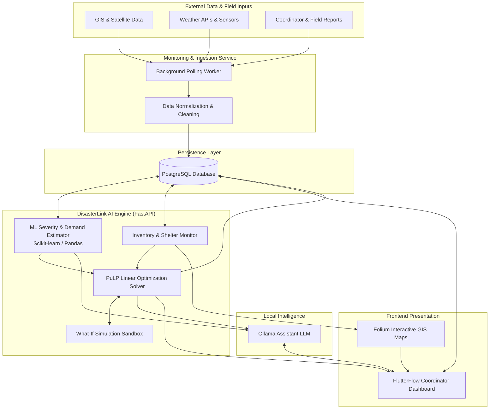
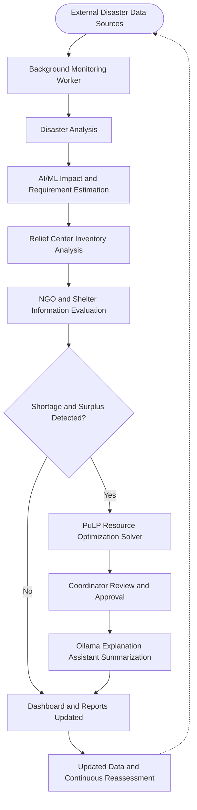
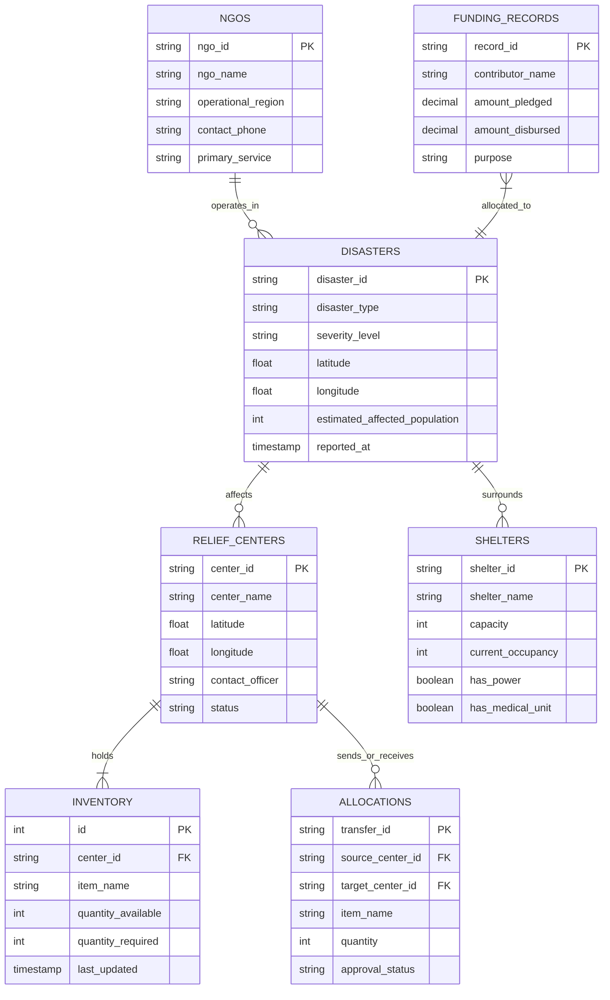

<div align="center">

# DisasterLink AI 🚨

### AI-Powered Multi-Disaster Monitoring, Prediction, and Dynamic Resource Coordination System

[](https://www.python.org/)
[](https://fastapi.tiangolo.com/)
[](https://www.postgresql.org/)
[](https://coin-or.github.io/pulp/)
[](https://ollama.ai/)
[](https://flutterflow.io/)
[](LICENSE)
[](#key-features)

<p align="center">
  <b>An intelligent decision-support platform unifying disaster surveillance, impact assessment, NGO logistics, and algorithmic relief distribution.</b>
</p>

---

</div>

## 📌 Project Banner / Logo

```
+---------------------------------------------------------------------------------+
|                                                                                 |
|     ██████╗ ██╗███████╗ █████╗ ███████╗████████╗███████╗██████╗ ██╗     ██╗     |
|     ██╔══██╗██║██╔════╝██╔══██╗██╔════╝╚══██╔══╝██╔════╝██╔══██╗██║     ██║     |
|     ██║  ██║██║███████╗███████║███████╗   ██║   █████╗  ██████╔╝██║     ██║     |
|     ██║  ██║██║╚════██║██╔══██║╚════██║   ██║   ██╔══╝  ██╔══██╗██║     ██║     |
|     ██████╔╝██║███████║██║  ██║███████║   ██║   ███████╗██║  ██║███████╗██║     |
|     ╚═════╝ ╚═╝╚══════╝╚═╝  ╚═╝╚══════╝   ╚═╝   ╚══════╝╚═╝  ╚═╝╚══════╝╚═╝     |
|                                                                                 |
|                   A I   -   L I N K     S Y S T E M                             |
|          Multi-Disaster Decision Support & Dynamic Resource Allocation          |
+---------------------------------------------------------------------------------+
```
> *Placeholder: Place your project banner graphic or logo here (`assets/banner.png`).*

---

## 📖 About the Project

**DisasterLink AI** is an intelligent disaster-management and decision-support platform designed to monitor multiple types of hazards (such as floods, cyclones, and earthquakes), evaluate real-time impact, project urgent relief demands, and dynamically coordinate supply transfers across geographically dispersed relief hubs.

During large-scale natural disasters, coordinating agencies face severe information fragmentation: field reports, volunteer NGO assets, government response depots, and emergency shelters operate in isolated silos. DisasterLink AI integrates these disparate data streams into a single unified dashboard, utilizing mathematical optimization (PuLP) and natural language AI explanations (Ollama) to help emergency coordinators make high-stakes allocation decisions swiftly and equitably.

> **Important Note:** DisasterLink AI is designed as a **college Data Science & AI engineering project**. It functions strictly as an analytical **decision-support platform** to assist planners, and does not directly operate or command government rescue units or financial institutions.

---

## ⚠️ Problem Statement

When severe natural calamities strike:
1. **Siloed Operational Awareness:** Disaster alerts, inventory records, NGO availability, and shelter statuses reside in disconnected databases and paper records.
2. **Delayed Impact & Needs Estimation:** Estimating requirements for rations, drinking water, and trauma kits across changing disaster perimeters often relies on slow manual calculations.
3. **Suboptimal Supply Logistics:** Relief centers frequently experience unbalanced resource hoarding—certain hubs experience severe supply deficits while neighboring depots hold unutilized surpluses.
4. **Coordination Overhead:** Disaster coordinators lack transparent, automated optimization models to quickly schedule inter-center transfers and evaluate hypothetical "what-if" disruption scenarios.

---

## 🎯 Project Objectives

- **Unified Crisis Aggregation:** Aggregate external disaster feeds, satellite observations, GIS coordinates, and field reports into a coherent database.
- **Predictive Severity & Demand Modeling:** Deploy machine learning models (Scikit-learn, Pandas, NumPy) to project affected populations, severity tiers, and minimum vital resource quotas (food, water, medical supplies).
- **Mathematical Resource Optimization:** Formulate and solve linear programming models (PuLP) to minimize supply deficits and transit costs between relief centers.
- **Transparent Decision Explanations:** Integrate a local LLM assistant (Ollama) to generate human-readable explanations of complex optimization math for field commanders.
- **Hypothetical Simulation:** Empower coordinators to test disruption scenarios (e.g., sudden influx of displaced persons or severed transport routes) using an interactive What-If Disaster Simulator.

---

## 🚀 Key Features

*The features below reflect the planned architectural scope of the DisasterLink AI system. Since the repository is currently in its initial codebase phase, implementation statuses are explicitly tagged below.*

| # | Feature | Description | Implementation Status |
|---|---------|-------------|-----------------------|
| 1 | **Multi-Disaster Monitoring** | Ingests data for floods, cyclones, earthquakes, and weather anomalies from GIS feeds, weather alerts, and field observations via periodic polling. | 🟡 *Under Development* |
| 2 | **AI/ML Disaster Analysis** | Employs predictive regression and classification models to estimate disaster perimeter severity, affected population size, and baseline emergency supplies. | 🟡 *Under Development* |
| 3 | **NDRF & SDRF Information Hub** | Read-only directory featuring National Disaster Response Force and State Disaster Response Force battalion contacts, jurisdictions, and standard protocols. | 🟡 *Under Development* |
| 4 | **NGO Registration & Coordination** | Registry enabling NGOs to register service areas, specialty volunteers, equipment, and medical capabilities, matching capabilities to relief needs. | 🟡 *Under Development* |
| 5 | **Relief Center Management** | Real-time multi-depot inventory tracking for essential survival commodities (water packs, ration kits, emergency medicine, blankets). | 🟡 *Under Development* |
| 6 | **Shelter Management** | Directory recording shelter coordinates, maximum intake capacity, live occupancy rates, and sanitation/electricity infrastructure. | 🟡 *Under Development* |
| 7 | **Dynamic Resource Allocation** | Formulates PuLP linear programming models to compute optimal resource transfers between surplus and deficit relief centers. | 🟡 *Under Development* |
| 8 | **Funding & Donation Tracking** | Transparent ledger logging monetary pledges, verified donations, approved disbursement lines, and remaining budget balances (non-payment processing). | 🟡 *Under Development* |
| 9 | **What-If Disaster Simulator** | Interactive testing sandbox allowing coordinators to simulate center closures, road blockages, and population surges to evaluate system resilience. | 🔵 *Planned* |
| 10 | **Ollama AI Assistant** | Offline/local conversational assistant explaining PuLP dispatch recommendations, summarizing situation reports, and parsing queries. | 🔵 *Planned* |
| 11 | **Coordinator Dashboard** | Unified FlutterFlow visualization displaying GIS Folium maps, inventory gauge charts, active alerts, and algorithmic transfer logs. | 🔵 *Planned* |

---

## 💡 Unique Features and Innovation

1. **Deterministic Optimization Paired with Local LLM (PuLP + Ollama):**
   Unlike black-box decision systems, DisasterLink AI couples deterministic, mathematically sound Linear Programming (PuLP) with a local LLM (Ollama). Coordinators obtain provably optimal logistics suggestions accompanied by clear, natural-language justifications.
2. **Dual Perspective Modeling (Shortage & Surplus Balancing):**
   Rather than treating relief centers as isolated consumers, the platform evaluates the regional network holistically, identifying dormant surpluses and calculating balanced, cost-effective inter-center transfers.
3. **Resilience Sandbox (What-If Simulator):**
   Enables coordinators to proactively conduct stress-testing drills before committing logistics convoys, simulating scenarios such as route failures or sudden localized evacuations.
4. **Air-Gapped & Offline Compatibility:**
   By utilizing Ollama for on-premises natural language processing and local PostgreSQL instances, core analysis remains functional even when broader internet connectivity is compromised during severe disasters.

---

## 🏗️ System Architecture



---

## 🔄 System Workflow

The end-to-end operational workflow follows a continuous closed-loop pipeline:



1. **Data Ingestion:** Automated background workers periodically poll external disaster sources, weather metrics, and field input records.
2. **Analysis & Estimation:** ML routines assess disaster magnitude, estimate affected perimeter population, and quantify vital resource requirements (water, meals, first-aid).
3. **Inventory & Gap Detection:** Live depot stock levels are audited against calculated requirements to identify localized shortages and surpluses.
4. **Algorithmic Dispatch:** PuLP formulates an optimal distribution matrix minimizing shortages and transportation overhead.
5. **Human-in-the-Loop Review:** The coordinator inspects suggested transfers, supported by Ollama's plain-English analytical summary.
6. **Continuous Loop:** Confirmed movements update inventory registers, triggering automatic recalculation as new telemetry arrives.

---

## 💻 Technology Stack

| Domain | Technology / Library | Purpose in DisasterLink AI |
|---|---|---|
| **Frontend** | [FlutterFlow](https://flutterflow.io/) | Responsive web and mobile dashboard for emergency coordinators |
| **Backend Framework** | [FastAPI](https://fastapi.tiangolo.com/) (Python 3.10+) | High-throughput asynchronous RESTful API services |
| **Database** | [PostgreSQL](https://www.postgresql.org/) (with PostGIS) | Relational database for GIS data, relief centers, and inventories |
| **Machine Learning** | [Scikit-learn](https://scikit-learn.org/) | Disaster severity classification and requirement estimation models |
| **Data Processing** | [Pandas](https://pandas.pydata.org/) & [NumPy](https://numpy.org/) | Telemetry aggregation, geospatial tabular wrangling, and analytics |
| **Mathematical Optimization** | [PuLP](https://coin-or.github.io/pulp/) | Linear Programming solver for cost- and deficit-optimized resource transfer |
| **Local AI Assistant** | [Ollama](https://ollama.ai/) (e.g., Llama 3 / Mistral) | On-premise reasoning model explaining optimization results |
| **Mapping & Geospatial** | [Folium](https://python-visualization.github.io/folium/) / Leaflet | Rendering interactive spatial maps with hazard zones and relief hubs |
| **Background Scheduling** | Python Background Worker / AsyncIO | Continuous background monitoring and periodic telemetry ingestion |
| **Inter-Service Communication** | RESTful JSON APIs | Standardized contracts linking the UI, ML engine, and database |

---

## 📁 Project Folder Structure

The repository follows a clean, modular structure separating backend microservices, optimization algorithms, data models, and UI components:

```text
disasterlink-ai/
├── backend/
│   ├── app/
│   │   ├── __init__.py
│   │   ├── main.py                     # FastAPI application entrypoint
│   │   ├── config.py                   # Environment configuration & settings
│   │   ├── api/
│   │   │   ├── __init__.py
│   │   │   ├── disasters.py            # Disaster tracking & GIS routes
│   │   │   ├── centers.py              # Relief center inventory endpoints
│   │   │   ├── ngos.py                 # NGO registry & capacity mapping
│   │   │   ├── shelters.py             # Emergency shelter capacity routes
│   │   │   ├── optimization.py         # PuLP resource allocation triggers
│   │   │   ├── simulator.py            # What-If scenario evaluation routes
│   │   │   ├── funding.py              # Grant & donation tracking routes
│   │   │   └── assistant.py            # Ollama query and explanation proxy
│   │   ├── ml/
│   │   │   ├── __init__.py
│   │   │   ├── impact_estimator.py     # Scikit-learn impact prediction models
│   │   │   └── demand_forecast.py      # Water, food, and medicine estimation
│   │   ├── optimization/
│   │   │   ├── __init__.py
│   │   │   └── pulp_solver.py          # Linear programming transfer formulation
│   │   ├── db/
│   │   │   ├── __init__.py
│   │   │   ├── session.py              # Database engine & session maker
│   │   │   └── models.py               # SQLAlchemy ORM schemas
│   │   ├── workers/
│   │   │   ├── __init__.py
│   │   │   └── monitor.py              # Periodic background polling daemon
│   │   └── services/
│   │       ├── __init__.py
│   │       ├── ollama_service.py       # Local Ollama client wrapper
│   │       └── map_generator.py        # Folium HTML map rendering
│   ├── tests/
│   │   ├── test_api.py                 # Backend unit & integration tests
│   │   └── test_optimizer.py           # Verification of PuLP balance models
│   ├── requirements.txt                # Python backend dependencies
│   └── Dockerfile                      # Backend container configuration
├── frontend/
│   ├── flutterflow_config/             # FlutterFlow project definitions & schemas
│   └── assets/                         # UI icons, branding, mock screenshots
├── docs/
│   ├── architecture.md                 # Deep-dive system design notes
│   └── api_spec.json                   # OpenAPI specification export
├── .env.example                        # Template for environment variables
├── .gitignore                          # Standard Python/Git ignore rules
├── LICENSE                             # Open-source license file
└── README.md                           # Master project documentation
```

---

## 🛠️ Installation and Setup Instructions

Follow these step-by-step instructions to set up the development environment locally.

### Prerequisites

Ensure you have the following installed on your system:
- **Python 3.10+**
- **PostgreSQL 14+**
- **Git**
- **Ollama** ([Download Ollama](https://ollama.ai/download))

### 1. Clone the Repository

```bash
git clone https://github.com/your-username/disasterlink-ai.git
cd disasterlink-ai
```

### 2. Set Up a Python Virtual Environment

```bash
python3 -m venv venv
source venv/bin/activate  # On Windows use: venv\Scripts\activate
```

### 3. Install Dependencies

```bash
pip install --upgrade pip
pip install -r backend/requirements.txt
```

*(If creating `backend/requirements.txt` from scratch during initial development, include: `fastapi`, `uvicorn[standard]`, `pydantic`, `sqlalchemy`, `psycopg2-binary`, `pulp`, `scikit-learn`, `pandas`, `numpy`, `folium`, `httpx`, `python-dotenv`).*

### 4. Configure Database

Initialize a PostgreSQL database instance:

```sql
CREATE DATABASE disasterlink_db;
CREATE USER disaster_admin WITH ENCRYPTED PASSWORD 'your_secure_password';
GRANT ALL PRIVILEGES ON DATABASE disasterlink_db TO disaster_admin;
```

### 5. Configure Local AI Assistant (Ollama)

Start the Ollama daemon and pull a lightweight model:

```bash
ollama serve &
ollama pull llama3
```

### 6. Run the Application

```bash
# Launch the FastAPI application server
cd backend
uvicorn app.main:app --host 0.0.0.0 --port 8000 --reload
```

The interactive API documentation will be accessible at `http://localhost:8000/docs`.

---

## 🔐 Environment Variables

Create a `.env` file in the `backend/` directory based on the following template. **Never commit raw credentials to version control.**

```env
# Application Settings
APP_NAME=DisasterLink-AI
APP_ENV=development
DEBUG=True
PORT=8000

# Database Configuration
DB_HOST=localhost
DB_PORT=5432
DB_NAME=disasterlink_db
DB_USER=disaster_admin
DB_PASSWORD=your_secure_password

# Ollama AI Configuration
OLLAMA_BASE_URL=http://localhost:11434
OLLAMA_MODEL=llama3

# Background Worker Settings
MONITOR_POLL_INTERVAL_SECONDS=300
```

---

## 📡 API Documentation

DisasterLink AI exposes structured RESTful endpoints organized by operational domain:

### Core Endpoints Overview

| Method | Endpoint | Description |
|---|---|---|
| `GET` | `/api/v1/disasters` | List all active monitored disaster events |
| `POST` | `/api/v1/disasters` | Register a new disaster event or observation |
| `GET` | `/api/v1/disasters/{id}/estimate` | Fetch ML impact and resource demand predictions |
| `GET` | `/api/v1/centers` | Retrieve all relief centers with stock levels |
| `POST` | `/api/v1/centers/{id}/inventory` | Update inventory balance (food, water, medicine) |
| `POST` | `/api/v1/optimization/solve` | Trigger PuLP solver to compute inter-depot transfers |
| `POST` | `/api/v1/simulator/simulate` | Run What-If simulation with modified parameters |
| `GET` | `/api/v1/ngos` | Retrieve certified NGO partners and active units |
| `GET` | `/api/v1/shelters` | Fetch shelter list with occupancy and capacities |
| `GET` | `/api/v1/funding/summary` | Retrieve donation ledgers and disbursement balance |
| `POST` | `/api/v1/assistant/chat` | Query the Ollama assistant for transfer explanations |

### Sample Optimization Request & Response

**POST** `/api/v1/optimization/solve`
```json
{
  "disaster_id": "DIS-2026-081",
  "resource_type": "water_packets",
  "max_transfer_radius_km": 150
}
```

**Response (`200 OK`)**:
```json
{
  "status": "optimal",
  "solver_time_ms": 42.8,
  "transfers": [
    {
      "source_center_id": "RC-NORTH-01",
      "target_center_id": "RC-DELTA-04",
      "quantity": 12000,
      "unit": "packets",
      "estimated_transit_km": 48.5
    }
  ],
  "deficit_mitigation_rate": 0.94,
  "unmet_demand": 800
}
```

---

## 🗄️ Database Structure

The underlying relational schema tracks disaster entities, resource states, and administrative logs:



---

## 🖼️ Screenshots Placeholder

Visual mockups and interface previews will be added here as the FlutterFlow frontend is connected:

| Coordinator Operations Center | PuLP Optimization Analysis |
|:---:|:---:|
|  <br> *Live Disaster Geo-View & Threat Tiers* |  <br> *Algorithmic Inter-Center Balance Matrix* |

| Shelter & NGO Registry | Ollama Explanation Chat |
|:---:|:---:|
|  <br> *Shelter Capacity & NGO Matching* |  <br> *Interactive Decision Justification Chat* |

---

## 🧪 Sample Demonstration Scenario

To illustrate how DisasterLink AI operates during a crisis:

1. **Detection:** A Category 3 Cyclone alert is logged along the coastal delta.
2. **Analysis:** The Scikit-learn impact model estimates that **45,000 residents** are directly impacted across three coastal sub-districts, establishing a minimum demand for **90,000 liters of drinking water** and **2,500 trauma kits**.
3. **Audit:** Inventory audits reveal that *Relief Hub Alpha (Inland)* holds a surplus of 60,000 liters, whereas *Relief Hub Delta (Coastal)* faces a critical deficit of 40,000 liters.
4. **Optimization:** The PuLP solver calculates that dispatching 35,000 liters from Hub Alpha to Hub Delta minimizes transit delays while retaining a safe contingency reserve at Hub Alpha.
5. **Explanation:** The coordinator asks the Ollama Assistant: *"Why was Hub Alpha selected instead of Hub Gamma?"*
   - **Ollama's Response:** *"Hub Alpha was selected because it is 32 km closer to Hub Delta, and Hub Gamma's supply margin is within 10% of its own local flood hazard projection."*
6. **Execution:** The coordinator confirms the transfer in the dashboard, generating consignment waybills for field logistics personnel.

---

## 🔮 Future Enhancements

- [ ] **Drone Fleet Routing:** Extend the PuLP mathematical model to solve vehicle routing problems (VRP) for autonomous medical delivery drones.
- [ ] **Edge Offline Synchronization:** Support mesh-network peer-to-peer data syncing between mobile relief workers when cellular towers fail.
- [ ] **Satellite Vision Segmentation:** Integrate deep learning models (e.g., U-Net) to process pre- and post-disaster satellite imagery for automated structural damage assessment.
- [ ] **Crowdsourced Hazard Reporting:** Build a verified civilian reporting portal for reporting localized flash floods and structural collapses.
- [ ] **Multilingual Audio Interface:** Integrate voice-based speech recognition for field officers communicating in regional Indian languages.

---

## ⚠️ Limitations & Disclaimers

1. **Decision-Support Scope Only:** DisasterLink AI is an academic and analytical decision-support system. It **does not command, deploy, or control** official military, NDRF (National Disaster Response Force), SDRF (State Disaster Response Force), or police personnel.
2. **No Real Financial Processing:** The funding tracking module functions solely as an accounting ledger for pledges and disbursements. It does **not** process live credit cards, UPI, or government treasury wire transactions.
3. **Satellite & Weather Latency:** The system does not guarantee real-time or hourly satellite feed refreshes; it relies on third-party public API availability and standard update intervals.
4. **Field Realities:** Algorithmic dispatch suggestions assume passable roadway corridors unless coordinators explicitly flag route closures in the What-If Simulator.

---

## 👥 Contributors

Developed as a **Data Science & AI Mini-Project**:

- **Lead Developer & AI Architect:** [Your Name / Team GitHub](https://github.com/your-username)
- **Data Engineering & Optimization:** [Contributor Name](https://github.com/contributor-username)
- **Frontend & Integration:** [Contributor Name](https://github.com/contributor-username)

*Academic Mentorship: Department of Computer Science & Engineering / Data Science.*

---

## 📄 License

This project is licensed under the **MIT License** - see the [LICENSE](LICENSE) file for details.
