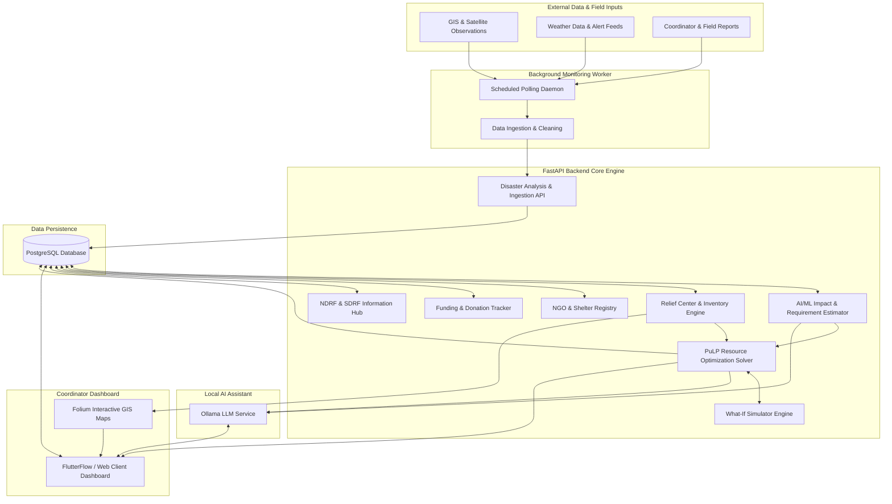
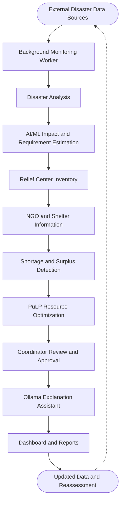
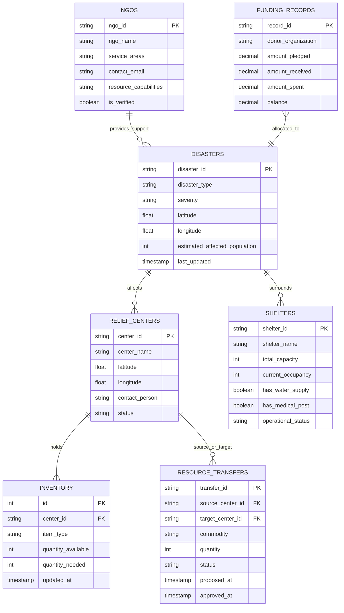

<div align="center">

# DisasterLink AI 🚨

### AI-Powered Multi-Disaster Monitoring, Prediction and Dynamic Resource Coordination System

[](https://www.python.org/)
[](https://fastapi.tiangolo.com/)
[](https://www.postgresql.org/)
[](https://coin-or.github.io/pulp/)
[](https://ollama.ai/)
[](https://flutterflow.io/)
[](LICENSE)
[](#key-features)

<p align="center">
  <b>An intelligent disaster-management and decision-support platform designed to monitor multiple types of disasters, analyze their impact, estimate resource requirements, and coordinate relief resources between different relief centers.</b>
</p>

---

</div>

## 📌 Project Logo or Banner Placeholder

```
+---------------------------------------------------------------------------------+
|                                                                                 |
|     ██████╗ ██╗███████╗ █████╗ ███████╗████████╗███████╗██████╗ ██╗     ██╗     |
|     ██╔══██╗██║██╔════╝██╔══██╗██╔════╝╚══██╔══╝██╔════╝██╔══██╗██║     ██║     |
|     ██║  ██║██║███████╗███████║███████╗   ██║   █████╗  ██████╔╝██║     ██║     |
|     ██║  ██║██║╚════██║██╔══██║╚════██║   ██║   ██╔══╝  ██╔══██╗██║     ██║     |
|     ██████╔╝██║███████║██║  ██║███████║   ██║   ███████╗██║  ██║███████╗██║     |
|     ╚═════╝ ╚═╝╚══════╝╚═╝  ╚═╝╚══════╝   ╚═╝   ╚══════╝╚═╝  ╚═╝╚══════╝╚═╝     |
|                                                                                 |
|                   A I   -   L I N K     S Y S T E M                             |
|          Multi-Disaster Decision Support & Dynamic Resource Allocation          |
+---------------------------------------------------------------------------------+
```
> *Placeholder: Place your project logo or banner graphic here (`assets/banner.png`).*

---

## 📖 About the Project

**DisasterLink AI** is an intelligent disaster-management and decision-support platform designed to monitor multiple types of disasters, analyze their impact, estimate resource requirements, and coordinate relief resources between different relief centers.

The primary objective of the system is to integrate fragmented information—such as disaster alerts, relief-center inventories, registered NGO assets, emergency shelter capacities, response-agency details, and funding records—into one unified, coherent platform.

Designed as an academic **college Data Science & AI mini-project**, DisasterLink AI serves as an analytical **decision-support platform** to empower disaster coordinators with actionable data, mathematical optimization (PuLP), and local AI explanations (Ollama).

---

## ⚠️ Problem Statement

During large-scale calamities (such as floods, cyclones, or earthquakes), disaster-response personnel encounter critical bottlenecks:
1. **Siloed & Fragmented Information:** Field reports, inventory logs, shelter occupancies, and NGO profiles are stored in disparate systems or manual records.
2. **Slow Impact & Demand Estimation:** Assessing affected populations and accurately projecting essential supplies (drinking water, meal rations, medical kits) is prone to delays.
3. **Inefficient Distribution & Imbalance:** Certain relief centers experience acute shortages while neighboring centers hold unallocated surpluses.
4. **Lack of Explainable Decision Support:** Coordinators lack intuitive tools to model logistical transfers, simulate "what-if" disruption scenarios, and receive transparent explanations for recommended resource movements.

---

## 🎯 Project Objectives

- **Unified Multi-Disaster Tracking:** Aggregate disparate disaster feeds, satellite observations, GIS information, and verified field reports into a single platform.
- **Data-Driven Impact Analysis:** Leverage machine learning models to classify disaster severity, estimate affected populations, and compute baseline survival requirements.
- **Deterministic Resource Optimization:** Formulate linear programming problems via PuLP to minimize shortages and calculate balanced center-to-center transfers.
- **Explainable AI Integration:** Connect a local Ollama LLM to summarize situational reports and explain the mathematical rationale behind resource allocations to coordinators.
- **Scenario Stress-Testing:** Provide a What-If Disaster Simulator allowing coordinators to test hypothetical population spikes, resource reductions, and facility closures.

---

## 🚀 Key Features

*The features below represent the planned capabilities of DisasterLink AI. Implementation statuses are explicitly highlighted below.*

| # | Feature | Details & Capabilities | Implementation Status |
|---|---------|------------------------|-----------------------|
| 1 | **Multi-Disaster Monitoring** | • Monitor floods, cyclones, earthquakes, and severe weather.<br>• Ingest weather data, satellite observations, GIS information, and field reports.<br>• Periodically check for newly available information. | 🟡 *Under Development* |
| 2 | **AI/ML-Based Disaster Analysis** | • Analyze incoming disaster information.<br>• Estimate affected areas and disaster severity.<br>• Estimate possible food, water, and medical requirements. | 🟡 *Under Development* |
| 3 | **NDRF and SDRF Information** | • Display official information about the National Disaster Response Force (NDRF) and State Disaster Response Force (SDRF).<br>• Provide relevant response-agency contacts and guidelines.<br>• *Note: Does not claim to control official rescue operations.* | 🟡 *Under Development* |
| 4 | **NGO Registration and Coordination** | • Allow verified NGOs to register on the platform.<br>• Maintain profiles, base locations, service jurisdictions, and available resources.<br>• Match potential NGO capabilities with disaster-related requirements. | 🟡 *Under Development* |
| 5 | **Relief Center Management** | • Track and manage food, water, medicine, and critical supplies.<br>• Automatically identify resource shortages and surpluses across centers. | 🟡 *Under Development* |
| 6 | **Shelter Management** | • Store shelter locations and total capacity.<br>• Track live occupancy and facility availability (power, water, sanitation). | 🟡 *Under Development* |
| 7 | **Dynamic Resource Allocation** | • Use PuLP optimization to calculate optimal resource distributions.<br>• Suggest transfers between relief centers.<br>• Factor in resource availability, priority weights, and transfer constraints.<br>• Require coordinator approval before recording transfers. | 🟡 *Under Development* |
| 8 | **Funding and Donation Tracking** | • Record funding pledges and verified received contributions.<br>• Track approved expenses and remaining fund balances.<br>• Generate transparent funding utilization reports.<br>• *Note: Real payment collection is not implemented.* | 🟡 *Under Development* |
| 9 | **What-If Disaster Simulator** | • Enable coordinators to evaluate hypothetical crisis situations.<br>• Simulate increased population, reduced resources, and offline relief centers.<br>• Dynamically recalculate resource allocations upon parameter changes. | 🔵 *Planned* |
| 10 | **Ollama AI Assistant** | • Explain resource allocation recommendations in plain language.<br>• Summarize disaster information and field reports.<br>• Answer coordinator queries using live project data. | 🔵 *Planned* |
| 11 | **Coordinator Dashboard** | • Single-pane-of-glass interface displaying disaster status, affected locations, resources, NGOs, shelters, and funding.<br>• Interactive maps, analytical charts, alerts, and optimization matrices. | 🔵 *Planned* |

---

## 💡 Unique Features and Innovation

1. **Integrated Deterministic Optimization (PuLP) + Explainable AI (Ollama):**
   Combines mathematically provable Linear Programming optimization with a local Ollama AI assistant that translates mathematical formulations into plain-English justifications for coordinators.
2. **Proactive Center-to-Center Balancing:**
   Evaluates regional supply networks holistically, computing inter-center transfers to bridge deficits from existing surpluses rather than relying entirely on external resupply.
3. **What-If Disaster Simulator Sandbox:**
   Provides coordinators with a proactive simulation environment to evaluate how changes in severity or sudden depot closures impact relief operations before committing logistical resources.
4. **Offline and Air-Gapped Capable Architecture:**
   By leveraging local models with Ollama and an on-premise PostgreSQL database, core decision-support capabilities remain operational during wide-area internet disruptions.

---

## 🏗️ System Architecture



---

## 🔄 System Workflow

The DisasterLink AI system coordinates data and decision flows through a structured, multi-stage pipeline:



1. **External Disaster Data Sources:** Collects raw weather alerts, GIS coordinates, and field reports.
2. **Background Monitoring Worker:** Continuously polls sources and updates database records.
3. **Disaster Analysis:** Categorizes disaster type, coordinates, and initial severity indicators.
4. **AI/ML Impact and Requirement Estimation:** Computes estimated affected populations and required food, water, and medical kits.
5. **Relief Center Inventory:** Audits real-time available stock levels across regional centers.
6. **NGO and Shelter Information:** Assesses active shelter capacities and matched NGO volunteer/resource support.
7. **Shortage and Surplus Detection:** Calculates net gaps between demand and local supplies.
8. **PuLP Resource Optimization:** Generates optimal distribution and inter-center transfer plans.
9. **Coordinator Review and Approval:** Human coordinators review suggestions and approve/reject transfers.
10. **Ollama Explanation Assistant:** Produces readable summaries detailing the logic behind allocation recommendations.
11. **Dashboard and Reports:** Displays comprehensive maps, statistics, alerts, and funding summaries.
12. **Updated Data and Reassessment:** System logs approved transfers and updates inventories, continuously repeating the loop as fresh data arrives.

---

## 💻 Technology Stack

| Component | Technology | Version / Spec | Purpose in DisasterLink AI |
|---|---|---|---|
| **Frontend** | [FlutterFlow](https://flutterflow.io/) | Modern Web / Mobile | Responsive coordinator dashboard, maps, charts, and alert center |
| **Backend Framework** | [FastAPI](https://fastapi.tiangolo.com/) | Python 3.10+ | Asynchronous RESTful API backend handling business logic and data routes |
| **Database** | [PostgreSQL](https://www.postgresql.org/) | 14+ (with PostGIS) | Relational database for disasters, relief centers, shelters, NGOs, and ledgers |
| **Machine Learning** | [Scikit-learn](https://scikit-learn.org/) | Latest | Predictive models for severity classification and requirement estimation |
| **Data Processing** | [Pandas](https://pandas.pydata.org/) & [NumPy](https://numpy.org/) | Latest | Geospatial and tabular data manipulation, cleaning, and preprocessing |
| **Optimization** | [PuLP](https://coin-or.github.io/pulp/) | Latest | Linear programming solver for multi-center resource allocation & transfers |
| **Local AI Assistant** | [Ollama](https://ollama.ai/) | Llama 3 / Mistral | On-premise language model for decision explanation and disaster summarization |
| **Geospatial & Mapping** | [Folium](https://python-visualization.github.io/folium/) | Latest | Interactive Leaflet-based map generation of disaster perimeters and centers |
| **Background Monitoring** | Python Background Worker | Threading / AsyncIO | Periodically checks external feeds and triggers re-analysis |
| **API Integration** | RESTful JSON APIs | OpenAPI / Swagger | Standardized communication interface between frontend, backend, and modules |

---

## 📁 Project Folder Structure

The repository is structured into modular backend, frontend, and documentation packages:

```text
disasterlink-ai/
├── backend/
│   ├── app/
│   │   ├── __init__.py
│   │   ├── main.py                     # FastAPI application entrypoint
│   │   ├── config.py                   # Environment settings & configuration
│   │   ├── api/
│   │   │   ├── __init__.py
│   │   │   ├── disasters.py            # Disaster monitoring & field reports
│   │   │   ├── analysis.py             # AI/ML impact & demand estimation
│   │   │   ├── centers.py              # Relief center inventory & gap detection
│   │   │   ├── ngos.py                 # NGO registration & capability matching
│   │   │   ├── shelters.py             # Emergency shelter capacity & occupancy
│   │   │   ├── response_agencies.py    # NDRF & SDRF official information hub
│   │   │   ├── optimization.py         # PuLP resource allocation & transfer approval
│   │   │   ├── simulator.py            # What-If disaster scenario evaluation
│   │   │   ├── funding.py              # Funding, pledges & expense tracking
│   │   │   ├── assistant.py            # Ollama AI chat & explanation endpoint
│   │   │   └── reports.py              # Utilization & disaster summary exports
│   │   ├── ml/
│   │   │   ├── __init__.py
│   │   │   ├── impact_estimator.py     # Severity & affected population model
│   │   │   └── demand_forecast.py      # Food, water, and medicine requirement models
│   │   ├── optimization/
│   │   │   ├── __init__.py
│   │   │   └── pulp_solver.py          # PuLP linear programming transfer formulation
│   │   ├── db/
│   │   │   ├── __init__.py
│   │   │   ├── session.py              # SQLAlchemy engine & session maker
│   │   │   └── models.py               # Database schemas & relationships
│   │   ├── workers/
│   │   │   ├── __init__.py
│   │   │   └── monitor.py              # Background polling & monitoring worker
│   │   └── services/
│   │       ├── __init__.py
│   │       ├── ollama_service.py       # Ollama LLM integration wrapper
│   │       └── map_generator.py        # Folium interactive HTML map builder
│   ├── tests/
│   │   ├── test_api.py                 # REST API endpoint tests
│   │   └── test_optimizer.py           # PuLP allocation solver tests
│   ├── requirements.txt                # Python backend package dependencies
│   └── Dockerfile                      # Backend container configuration
├── frontend/
│   ├── flutterflow_config/             # FlutterFlow schema configurations & UI definitions
│   └── assets/                         # Visual assets, branding icons, and screenshots
├── docs/
│   ├── system_design.md                # System design & architecture deep-dive
│   └── api_spec.json                   # OpenAPI 3.0 specification export
├── .env.example                        # Template for environment variables
├── .gitignore                          # Standard git ignore definitions
├── LICENSE                             # MIT Open Source License
└── README.md                           # Master project documentation
```

---

## 🛠️ Installation and Setup Instructions

Follow these step-by-step instructions to run DisasterLink AI in your local development environment.

### Prerequisites

Ensure the following tools are installed:
- **Python 3.10 or higher**
- **PostgreSQL 14 or higher**
- **Git**
- **Ollama** ([Download & Install Ollama](https://ollama.ai/download))

### 1. Clone the Repository

```bash
git clone https://github.com/your-username/disasterlink-ai.git
cd disasterlink-ai
```

### 2. Set Up a Python Virtual Environment

```bash
python3 -m venv venv
source venv/bin/activate  # On Windows: venv\Scripts\activate
```

### 3. Install Backend Dependencies

```bash
pip install --upgrade pip
pip install -r backend/requirements.txt
```

*(Core libraries installed: `fastapi`, `uvicorn[standard]`, `pydantic`, `sqlalchemy`, `psycopg2-binary`, `pulp`, `scikit-learn`, `pandas`, `numpy`, `folium`, `httpx`, `python-dotenv`).*

### 4. Set Up the PostgreSQL Database

Create the database and assign credentials via the PostgreSQL prompt:

```sql
CREATE DATABASE disasterlink_db;
CREATE USER disaster_admin WITH ENCRYPTED PASSWORD 'your_secure_password';
GRANT ALL PRIVILEGES ON DATABASE disasterlink_db TO disaster_admin;
```

### 5. Launch the Ollama AI Assistant

Ensure the Ollama service is running and download your preferred model:

```bash
ollama serve &
ollama pull llama3
```

### 6. Run the FastAPI Application Server

```bash
cd backend
uvicorn app.main:app --host 0.0.0.0 --port 8000 --reload
```

The server will be available at `http://localhost:8000`. You can inspect the interactive Swagger API documentation at `http://localhost:8000/docs`.

---

## 🔐 Environment Variables

Create a `.env` file in the `backend/` directory using the provided `.env.example` template. **Never commit passwords or private API keys to version control.**

```env
# General Settings
APP_NAME=DisasterLink-AI
APP_ENV=development
DEBUG=True
PORT=8000

# PostgreSQL Database Configuration
DB_HOST=localhost
DB_PORT=5432
DB_NAME=disasterlink_db
DB_USER=disaster_admin
DB_PASSWORD=your_secure_password

# Ollama AI Assistant Configuration
OLLAMA_BASE_URL=http://localhost:11434
OLLAMA_MODEL=llama3

# Background Monitoring Worker
MONITOR_POLL_INTERVAL_SECONDS=300
```

---

## 📡 API Documentation

DisasterLink AI provides comprehensive RESTful endpoints across all core functional domains:

### Overview of Primary Endpoints

| Method | Endpoint | Description |
|---|---|---|
| `GET` | `/api/v1/disasters` | Retrieve all actively monitored disaster events |
| `POST` | `/api/v1/disasters` | Create a new disaster event or submit a field report |
| `GET` | `/api/v1/analysis/{id}/estimate` | Get AI/ML severity and resource requirement estimates |
| `GET` | `/api/v1/centers` | List all relief centers, contact information, and coordinates |
| `POST` | `/api/v1/centers/{id}/inventory` | Update center inventory for food, water, and medicine |
| `GET` | `/api/v1/centers/gaps` | Audit and return current resource shortages and surpluses |
| `POST` | `/api/v1/optimization/solve` | Calculate optimal resource transfers using PuLP |
| `POST` | `/api/v1/optimization/approve` | Approve a suggested transfer between centers |
| `POST` | `/api/v1/simulator/run` | Execute a What-If disaster simulation with modified parameters |
| `GET` | `/api/v1/ngos` | Retrieve registered NGOs, operational regions, and resources |
| `POST` | `/api/v1/ngos/register` | Register a new NGO profile with service capabilities |
| `GET` | `/api/v1/shelters` | List shelter facilities, capacities, and occupancy rates |
| `GET` | `/api/v1/agencies/ndrf-sdrf` | Fetch official NDRF/SDRF battallion and response force details |
| `GET` | `/api/v1/funding/summary` | Retrieve funding pledges, received contributions, and expenses |
| `POST` | `/api/v1/assistant/chat` | Send a coordinator query to the Ollama explanation assistant |

### Sample PuLP Optimization Request and Response

**POST** `/api/v1/optimization/solve`
```json
{
  "disaster_id": "DIS-2026-FLOOD-01",
  "commodity": "potable_water_liters",
  "max_transfer_distance_km": 120.0
}
```

**Response (`200 OK`)**:
```json
{
  "status": "optimal",
  "objective_value": 4.25,
  "execution_time_ms": 38.6,
  "transfers": [
    {
      "source_center_id": "RC-NORTH-01",
      "target_center_id": "RC-COASTAL-03",
      "commodity": "potable_water_liters",
      "quantity": 15000,
      "distance_km": 42.1,
      "approval_required": true
    }
  ],
  "shortage_reduction_percentage": 92.5,
  "unmet_demand_remaining": 1200
}
```

---

## 🗄️ Database Structure

The entity-relationship model captures disaster records, inventory metrics, logistics transfers, and administrative ledgers:



---

## 🖼️ Screenshots Placeholder

Interface previews and dashboard mockups from the FlutterFlow coordinator client:

| Multi-Disaster Command Dashboard | PuLP Optimization & Transfer Engine |
|:---:|:---:|
|  <br> *Live Disaster Feed, Severity Tiers & Folium Map* |  <br> *Center Shortage/Surplus & Transfer Suggestions* |

| Shelter & NGO Coordination View | Ollama AI Decision Assistant |
|:---:|:---:|
|  <br> *Shelter Capacities & NGO Matchmaking* |  <br> *Natural-Language Transfer Explanations & Summaries* |

---

## 🧪 Sample Demonstration Scenario

Here is how DisasterLink AI operates during an emergency event:

1. **Disaster Observation:** The background worker ingests an alert indicating a severe cyclone warning impacting coastal districts.
2. **AI/ML Estimation:** The estimation model predicts that **35,000 residents** will be displaced in low-lying sub-districts, calculating an immediate initial requirement of **70,000 liters of drinking water**, **35,000 meal packs**, and **1,800 medical kits**.
3. **Inventory & Gap Detection:** Live depot queries indicate:
   - *Relief Depot 1 (Inland):* Holds a surplus of 50,000 liters of potable water.
   - *Relief Depot 4 (Coastal Delta):* Faces an immediate deficit of 30,000 liters of potable water.
4. **PuLP Dynamic Allocation:** The PuLP solver computes an optimal dispatch: transferring 28,000 liters from Depot 1 to Depot 4 minimizes transit distance (52 km) while maintaining a safe operating threshold at Depot 1.
5. **Coordinator Consultation:** The coordinator queries the Ollama AI Assistant:
   - *Coordinator:* "Why did the system recommend transferring water from Depot 1 rather than Depot 2?"
   - *Ollama Assistant:* "Depot 1 is 35 km closer to Depot 4 than Depot 2, saving approximately 45 minutes in transit. Additionally, Depot 2 is located near a river gauge showing rising flood thresholds."
6. **Coordinator Approval:** The coordinator reviews the plan and officially marks the transfer as approved.

---

## 🔮 Future Enhancements

- [ ] **Drone Logistics Routing:** Incorporate Vehicle Routing Problem (VRP) solvers for autonomous emergency medical delivery drones.
- [ ] **Edge Peer-to-Peer Syncing:** Implement mesh networking for offline data synchronization between frontline volunteers when cellular connectivity is disabled.
- [ ] **Automated Satellite Imagery Segmentation:** Integrate deep learning models (e.g., U-Net) to analyze satellite imagery for flood extent and building structural damage.
- [ ] **Civilian Crowdsourcing Portal:** Deploy a verified reporting interface for citizens to submit localized alerts and geotagged damage reports.
- [ ] **Regional Language Speech Support:** Implement multilingual voice-to-text input to facilitate fast field reporting by local coordinators.

---

## ⚠️ Limitations & Disclaimers

1. **Decision-Support Platform Only:** DisasterLink AI is strictly a decision-support and analytical platform designed for academic and training purposes. It **does not command, deploy, or control** official National Disaster Response Force (NDRF), State Disaster Response Force (SDRF), armed forces, or law enforcement units.
2. **No Real Financial Processing:** The funding tracking module functions solely as an administrative ledger for recording pledges, receipts, and approved expenditures. It does **not** process live monetary transactions, card payments, or government disbursements.
3. **Data Availability & Latency:** The system relies on external public weather and disaster APIs. It **does not claim or guarantee hourly satellite data updates**, as update frequencies depend entirely on external satellite and provider schedules.
4. **Human-in-the-Loop Requirement:** All resource transfer recommendations generated by PuLP optimization require explicit coordinator review and approval before execution.

---

## 👥 Contributors

Developed as a **College Data Science & AI Mini-Project**:

- **Lead AI Architect & Optimization:** [Your Name / GitHub Profile](https://github.com/your-username)
- **Data Engineering & Backend Systems:** [Contributor Name](https://github.com/contributor-username)
- **Frontend Dashboard & UI Integration:** [Contributor Name](https://github.com/contributor-username)

*Department of Computer Science & Engineering / Data Science.*

---

## 📄 License

This project is licensed under the **MIT License** - see the [LICENSE](LICENSE) file for details.
